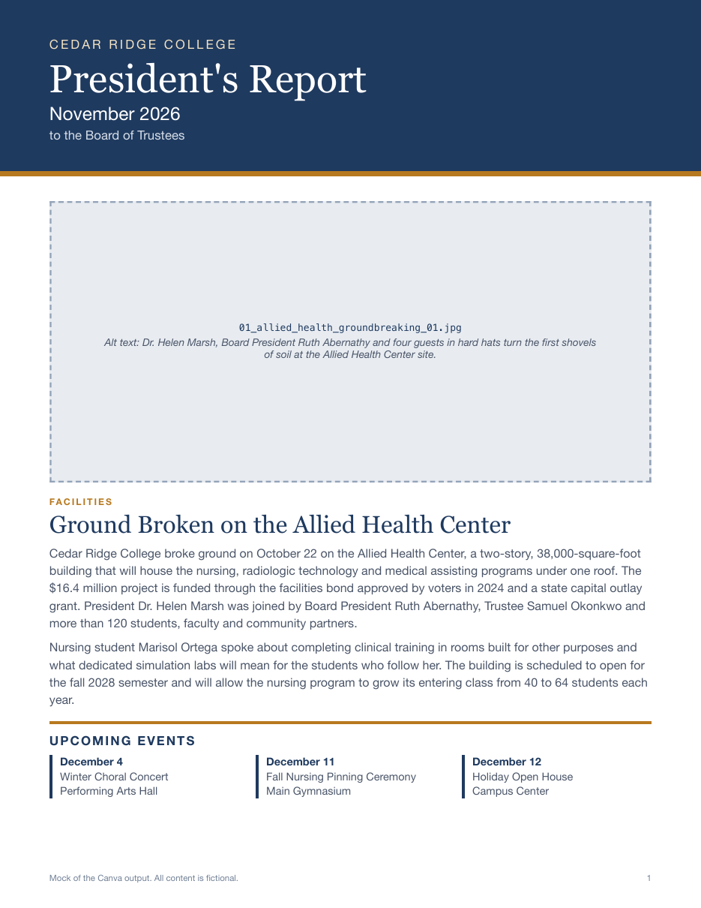

# Monthly board report in Canva

A Claude skill that builds the President's monthly report to the Board of Trustees in
Canva. I'm Andrew Park, an executive assistant in a college communications office. The
report is a few pages of short stories and event photos that goes in the Board's packet
every month. This skill copies last month's report as the template, drafts the stories,
places the photos and exports the PDF, and it does not touch Canva until a person has
approved the story text.

Everything in this repository is fictional. The college, its people and the sample month
are invented, and no real report, design or photo is included.



The image above and the sample PDF are a stand-in for the Canva output. Canva cannot run
inside a repository, so I rendered the sample month as a plain HTML page
in a neutral style to show what the finished report holds. Grey boxes mark where the photos
go, with the alt text the skill writes for each.

## How it works

The sample folder follows one month, November 2026 at the fictional Cedar Ridge College,
through every step.

| Step | What happens | Sample file |
|---|---|---|
| 1. Inputs | I give Claude the month, the story list in priority order, my notes for each story, and the Canva folder the photographer uploaded to | [`01_story_list.md`](sample/01_story_list.md) |
| 2. Draft | Claude looks at each photo, matches it to a story, and drafts every story in the Board's third-person voice. Anything it could not verify is flagged | [`02_story_spec_draft.md`](sample/02_story_spec_draft.md) |
| 3. Approval | A person answers the flags, edits the text and approves it. Nothing in Canva changes before this | [`03_approval_record.md`](sample/03_approval_record.md) |
| 4. Copy | Claude copies last month's report in Canva and renames the copy. The original is never edited | |
| 5. Fill | It replaces each headline and story and places each photo with alt text, then shows a preview | |
| 6. Export | After an OK on the preview, it saves the changes and exports a letter-size PDF | [`04_board_report.pdf`](sample/04_board_report.pdf) (mock) |

Claude does the writing and the Canva work. The layout comes from copying last month's
design, so the report keeps the same look month to month and nobody rebuilds it.

## The approval gate

A wrong name or number in a report to the Board is the mistake this skill is built to
prevent. Claude does not guess at a fact. When it cannot confirm one from the material it
was given, it marks it in the draft and keeps going. When it cannot tell who is in a photo,
it says so and asks for a caption.

The sample shows the gate working. Claude's draft gave the new building's cost as
$18 million, from an old project list, and flagged it. The correct figure was
$16.4 million:

> Before: The **$18 million** project is funded through the facilities bond...
>
> After: The **$16.4 million** project is funded through the facilities bond...

In the same review the reviewer cut a sentence that made a claim nobody could check,
corrected the new dean's title, and named a speaker Claude could not identify from the
photo. All of that happened in text, where a fix takes seconds. Only then did Claude open
Canva.

## A colleague runs it now

The most recent board report was made on a colleague's computer, not mine. He is the
office photographer. I sent him the skill file, his Claude installed it and updated the
file pointers to match his computer, and I helped him connect Canva in his Claude desktop
app. He now runs the report himself.

## How it was built

I built the skill in July 2026 by directing Claude, and it has produced the monthly board
report since about September 2026. A few rules in it came from problems hit while getting
it working:

- Canva's short preview links are snapshots, so a link taken before saving shows the old
  version and looks like the edit failed. The skill fetches fresh links after every save.
- Canva can only bring in a photo from a public web address or a Canva folder. The skill
  asks for a Canva folder and never makes a private photo public to get around that.
- Alt text is written in the same step that places each photo, so it is never left for
  later.

## Run it yourself

You need Claude with the Canva connector turned on, and a Canva account holding at least
one finished report to use as the template. The skill always copies an existing design; it
does not create a layout from nothing.

1. Copy `skill/board-report/` into your Claude skills folder.
2. Fill in the file pointers. The skill uses placeholders such as `{{CANVA_REPORT_FOLDER}}`
   and `{{PEOPLE_LIST}}` for the locations that differ on every computer; the table at the
   top of `SKILL.md` lists them. You can ask Claude to do this: give it the skill folder and
   tell it where each item lives. This is the step my colleague's Claude did when he
   installed it.
3. Put the month's photos in a Canva folder, then ask Claude to "build the November board
   report" and give it your story list.

## What's here

```
skill/board-report/SKILL.md                 the instructions Claude follows
skill/board-report/references/playbook.md   the Canva steps, the report layouts and the story format
skill/board-report/references/decisions.md  the choices: which report to copy, photo access, matching photos, responsive pages
sample/                                     one fictional month, story list to finished report
docs/mock_report.html                       the HTML used to render the mock report
docs/report_page-1.png                      first page of the mock report
```

Released under the MIT License.
